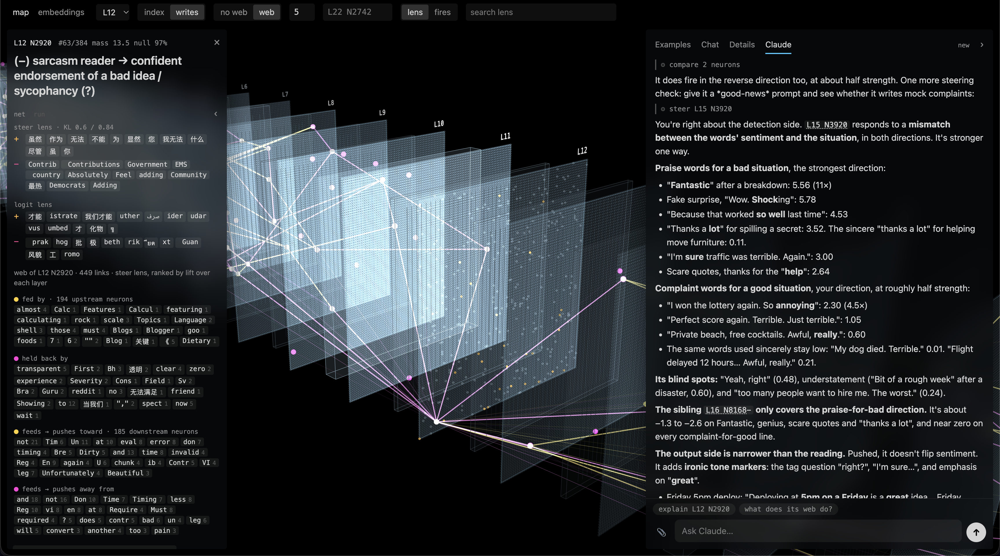

# neuron explorer

Steering-first neuron explorer for Qwen3.5-4B. Every MLP neuron in a layer is pushed up and down on a few prompts, every
rollout is kept, and the explorer lays the results out over a 3D view of the model.

Started as a fork of [lyramakesmusic/neuron-explorer](https://github.com/lyramakesmusic/neuron-explorer) (MIT), which is
where the idea, the 3D map and the sweep harness come from. Everything below the upstream base is mine: the persons
layer, the money lens, the advisor bridge, the live firing view, and the verification scripts. See
[Provenance](#provenance) for what changed and why the history looks newer than the upstream repo.

## Explorer

    uv sync
    uv run python explorer/server.py        # http://localhost:8791

Reads sweep runs from `runs/` and per-layer stats from `stats/`, both produced by the sweep below; the caches in
`explorer/cache/` ship with the repo. Loads Qwen3.5-4B locally (MPS, CUDA or CPU) for live
steered chat, lens, connections and live inference over your own text.

- **map**: the model's layers in perspective, attention and MLP per layer, one point per neuron. Hover shows a neuron's
  steer lens and logit lens; click opens it; click a layer's label to view its sheet face-on. `writes` places
  neurons with similar down-projection columns next to each other.
- **list**: units ranked by word-cluster mass against random-direction controls; `lens` searches the steer and logit
  lenses for a token, `fires` runs your text through the model and filters neurons by activation.
- **neuron**: steered rollouts per prompt and dose, a three-column multi-turn steered chat (−, 0, +), lens and
  connections, and a name.
- **person**: a named set of neurons pushed together, saved as `persons/<slug>.json`, talked to as one voice in
  the chat's person bar, with per-token firing lighting the map while it speaks. See `PERSONS.md`.
- **embeddings**: UMAP of a layer's rollouts, coloured by neuron, prompt, dose or kind.
- **Claude** (fourth neuron-panel tab, or the right-edge handle): a chat running the `claude` CLI (installed and
  logged in) with the explorer as an MCP server (`explorer/agent_mcp.py`). It reads neurons, cones and lenses, runs the
  live model (steering, activations, next-token logprobs, ablations), moves the map, list and highlights, and has file
  tools and a shell in your home folder. Its prompt is `explorer/agent_prompt.md` plus `explorer/agent_methodology.md`, and
  `explorer/agent_prompt.local.md` when present (untracked, for your own additions);
  `EXPLORER_CLAUDE_MODEL` picks the model. The server answers only pages and tools on this machine.

## Sweep

Runs on a CUDA 13 GPU pod with the steering fork of vLLM ([RhizoNymph/vllm](https://github.com/RhizoNymph/vllm)).

    bash sweep/setup_pod.sh                                   # fork, deps, model; writes /workspace/env.sh
    python sweep/neuron_stats.py --layers 22 --tokens 2000000 --out stats/q35-4b
    python sweep/steer_sweep.py --stats stats/q35-4b_L22.npz --design main_rel --dose-unit rel \
        --neurons all --random-controls 256 --run q35-4b-L22
    sweep/run_depth.sh "4 9 13 17" 384 64                     # random-subset sweep across several layers

`main_rel` doses are fractions of the median residual norm leaving the layer: {who, snake, orange} × {−0.7, +0.5, +0.8}
and {free} × {+3}, plus one unsteered baseline per prompt.

| script | output |
|---|---|
| `sweep/neuron_stats.py` | per-neuron activation extremes by sign regime, down columns, residual norms |
| `sweep/steer_sweep.py` | `runs/<run>.jsonl`: text, token ids, logprobs, top-k per step; optional activation captures |
| `sweep/rank.py` | `runs/<run>.units.jsonl`: distinctive words, cluster mass, percentile against controls |
| `sweep/steer_lens.py` | `stats/steer_lens_L{l}.npz`: next-token Δlogprob and KL for ±0.8 pushes on every neuron |
| `sweep/depth_report.py` | `runs/depth_report.json`: per-layer share of neurons above controls, coherence, top units |
| `sweep/shift.py` | word-shift score against controls, all words counted |
| `sweep/merge_runs.py` | joins sharded runs of one layer |
| `sweep/check_equivalence.py` | HF vs vLLM steering and capture agreement |
| `sweep/bench.py`, `sweep/peek.py` | throughput conditions; terminal views of a run |
| `explorer/build_embeddings.py` | `runs/<run>.umap.json` |
| `explorer/build_layout.py` | `explorer/cache/layout_writes.npz` |
| `explorer/build_connections.py` | `explorer/cache/connections.npz`: each neuron's 24 strongest direct-path links up and down |
| `scripts/verify_person.py` | end-to-end check of persons + live firing against a running server |
| `scripts/verify_reading.py` | offline check of the reading merge, plus the live stream against a running server |
| `scripts/pull_taps.py` | pulls the public advisor's replayable exchanges from the Jetson into `explorer/cache/advisor_taps/` |
| `scripts/verify_taps.py` | the tap writer and `/taps` reader, against the real server module with the model stubbed |
| `sweep/capture_prefill.py` | `captures/<run>.mlp_in.npy`: MLP input at the last prompt token at the run's capture layers, steered |

`research_log.md` holds the findings and reasoning; `NOTES.md` the source notes.

## Checking it actually works

Five scripts assert rather than print and hope. None of them need a GPU except
`check_equivalence.py`, and none of them need a sweep to have just finished.

    uv run python scripts/verify_runs.py ~/neuron-explorer     # is a pulled sweep complete, per layer?
    uv run python scripts/verify_person.py                     # persons + per-token firing, against :8791
    uv run python scripts/verify_money.py                      # money lens end to end, then the screen re-derived
    uv run python scripts/verify_reading.py                    # the reading merge, then --live for the stream
    uv run python scripts/pull_taps.py                         # public answers from the Jetson, for replay
    uv run python scripts/verify_taps.py                       # the tap writer and reader, model stubbed
    uv run python sweep/check_equivalence.py --stats stats/q35-4b_L22.npz --neurons 2742,17,5000

`verify_runs.py` exists because the pipeline's one real data-loss mode is a
partial pull: the runs come back missing an output directory the meta named and
nothing notices until the pods are gone. It checks completeness structurally,
since `meta.json` does not record the neuron range or the control count.

`verify_money.py` re-derives every screen criterion from the numbers the report
already printed, so a row claiming 3/5 has to earn those three from its own
figures.

## Provenance

This began as a fork of [lyramakesmusic/neuron-explorer](https://github.com/lyramakesmusic/neuron-explorer). Upstream
supplies the concept, the 3D map view and the first version of the sweep harness; the persons layer, the money lens, the
advisor bridge, live per-token firing and the verification scripts are additions on top.

The fork's history was unusable as a portfolio piece: its two branches had separate roots (one of them a bulk tarball
upload from a GPU pod) and one commit was a blanket "commit pending changes" sweep of the working tree. The work was
re-landed here on a single linear history with messages that state what changed and why. Commit dates and authorship
are from the original work; nothing was re-dated to look busier. Two identities appear in the log that are not this
GitHub handle: `Doctor Strange` is the git identity the GPU pod had configured, and `Lyra C` is the identity on the
imported upstream snapshot. Both are my commits either way. If you want to compare against upstream, do it on content,
not on commit count.

## Status

Working: the explorer, the sweep pipeline, persons, the money lens, the Claude agent bridge, and the four verification
scripts. The caches under `explorer/cache/` (~53 MB of `.npz`) ship with the repo on purpose, so the map opens without
re-running a sweep.

Not done:

- One model and one layer set are exercised (Qwen3.5-4B, layer 22 plus the depth sweep). Nothing else is tested.
- No CI. The checks need a running server and a local model, so they are manual by design rather than faked green.
- The sweep requires a CUDA 13 pod and a vLLM fork; there is no CPU path.
- `reports/screen-2026-10-26.json` is one run against one market snapshot. The criteria are written down, the backtest
  is not.
- No packaging: no `pip install`, no entry point, no version pin for the model weights.

## License

MIT, inherited from upstream. See [LICENSE](LICENSE).

